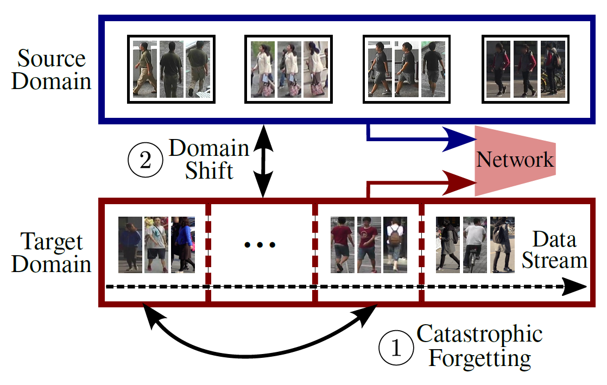
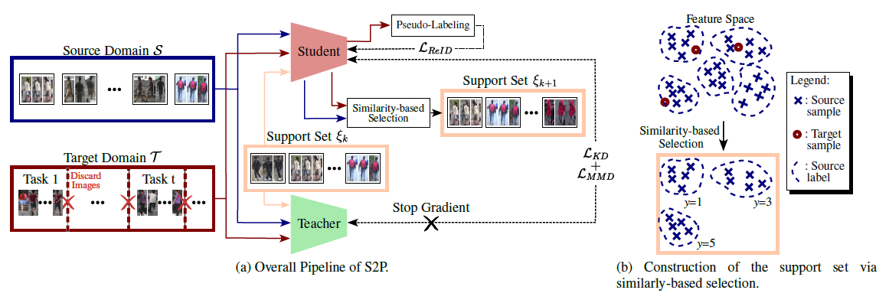

# Source-Guided Similarity Preservation (S2P)

Code of the paper **"Source-Guided Similarity Preservation for Online Person
Re-Identification"**, H. Rami et al., WACV 2024
([paper](https://openaccess.thecvf.com/content/WACV2024/papers/Rami_Source-Guided_Similarity_Preservation_for_Online_Person_Re-Identification_WACV_2024_paper.pdf)).

<p align="center"></p>

Online Unsupervised Domain Adaptation (OUDA) for person re-identification
adapts a model trained on a labelled source domain to a target domain observed
as a stream. The model faces both domain shift and catastrophic forgetting.
S2P extracts a *support set* of source images that are the most similar to the
target data, and preserves the feature similarities of this support set while
the model learns. It plugs into existing UDA methods (MMT, SpCL).

<p align="center"></p>

## Repository layout

```
s2p/            the method: online data stream, support set, losses, runners, training CLI
configs/        ready-to-use configs (MMT and SpCL, MSMT17 -> Market-1501)
scripts/        multi-GPU and Slurm launchers
tests/          unit and end-to-end tests (run on CPU with synthetic data)
OpenUnReID/     vendored re-ID toolbox (upstream + 5 small patches, see OpenUnReID/S2P_PATCHES.md)
docs/AUDIT.md   audit of the original release and list of changes in behaviour
```

## Installation

Tested with Python 3.10 and PyTorch 1.13.1.

```bash
conda create -n s2p python=3.10 -y
```

```bash
conda activate s2p
```

```bash
conda install pytorch==1.13.1 torchvision==0.14.1 pytorch-cuda=11.7 -c pytorch -c nvidia
```

```bash
conda install -c pytorch faiss-gpu
```

```bash
pip install -r OpenUnReID/requirements.txt
```

```bash
pip install -e OpenUnReID
```

```bash
pip install -e ".[dev]"
```

`pip install -e OpenUnReID` compiles the Cython evaluation code. Prefer the
conda build of faiss: the `faiss-gpu` wheels on PyPI stop at Python 3.10.

## Data

Datasets go under one root (`DATA_ROOT`, default `./data/datasets/`), with the
layout described in
[OpenUnReID/docs/INSTALL.md](OpenUnReID/docs/INSTALL.md#prepare-datasets).
Supported names in `TRAIN.datasets` / `TEST.datasets`: `market1501`,
`dukemtmcreid`, `msmt17`, `cuhk03-np` (`<root>/cuhk03-np/labeled/...`) and
`custom_<directory>` for a dataset described by `list_<mode>.csv` files with the
columns `path,id,camid` (used for RandPerson).

S2P starts from a model **pre-trained on the source domain**. Train it with
the OpenUnReID source pre-training tool:

```bash
PYTHONPATH=OpenUnReID python OpenUnReID/tools/source_pretrain/main.py OpenUnReID/tools/source_pretrain/config.yaml --work-dir source_msmt17
```

## Training

One GPU:

```bash
python -m s2p.train configs/mmt_msmt17_to_market1501.yaml --work-dir mmt_s2p --source-pretrained logs/source_msmt17/model_best.pth
```

Several GPUs (`GPUS` defaults to 2):

```bash
GPUS=4 scripts/dist_train.sh configs/mmt_msmt17_to_market1501.yaml mmt_s2p --source-pretrained logs/source_msmt17/model_best.pth
```

Slurm: `sbatch scripts/slurm_train.sh <config> <run name> [options]` (edit the
`#SBATCH` lines for your cluster).

Main options (all of them can also be set in the config):

| option | config key | |
|--------|------------|-|
| `--method mmt\|spcl` | `METHOD` | base UDA method |
| `--n-tasks N` | `OUDA.n_tasks` | number of identity-disjoint target tasks (5) |
| `--epochs`, `--iters` | `TRAIN.epochs`, `TRAIN.iters` | per task |
| `--kd s2p\|lwf\|sp\|at` | `S2P.kd` | distillation on the support set (`s2p` = ours, others are baselines) |
| `--kd-weight W` | `S2P.kd_weight` | 0 disables the distillation |
| `--mmd-weight W` | `S2P.mmd_weight` | 0 disables the MMD term |
| `--data-root`, `--logs-root`, `--source-pretrained`, `--backbone-path` | | paths |
| `--resume-from logs/<run>/task_<k>.pth` | | restart at task k+1 |
| `--set KEY VALUE ...` | any | e.g. `--set TRAIN.LOADER.samples_per_gpu 32` |

`--kd-weight 0 --mmd-weight 0` gives the base method in the online setting.

Outputs in `LOGS_ROOT/<work-dir>/`: `log.txt`, `config.yaml`, TensorBoard
logs in `tb/`, `results.json` (mAP / rank-1 before adaptation and after each
task), `checkpoint.pth` (latest) and `task_<k>.pth` (end of each task).

## Tests

```bash
pytest -m "not slow"
```

```bash
pytest
```

The full suite trains MMT and SpCL with S2P end to end on tiny synthetic
datasets (about two minutes on CPU, no GPU required).

## Citation

```bibtex
@inproceedings{rami2024s2p,
  title     = {Source-Guided Similarity Preservation for Online Person Re-Identification},
  author    = {Rami, Hamza and others},  % TODO: complete the author list
  booktitle = {Proceedings of the IEEE/CVF Winter Conference on Applications of Computer Vision (WACV)},
  year      = {2024}
}
```

## Acknowledgement

Built upon [OpenUnReID](https://github.com/open-mmlab/OpenUnReID) (Apache-2.0).
